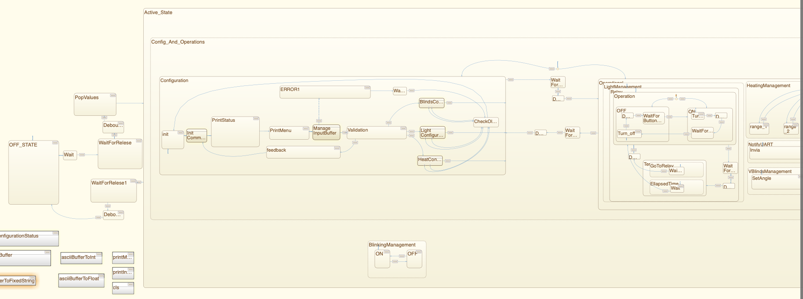
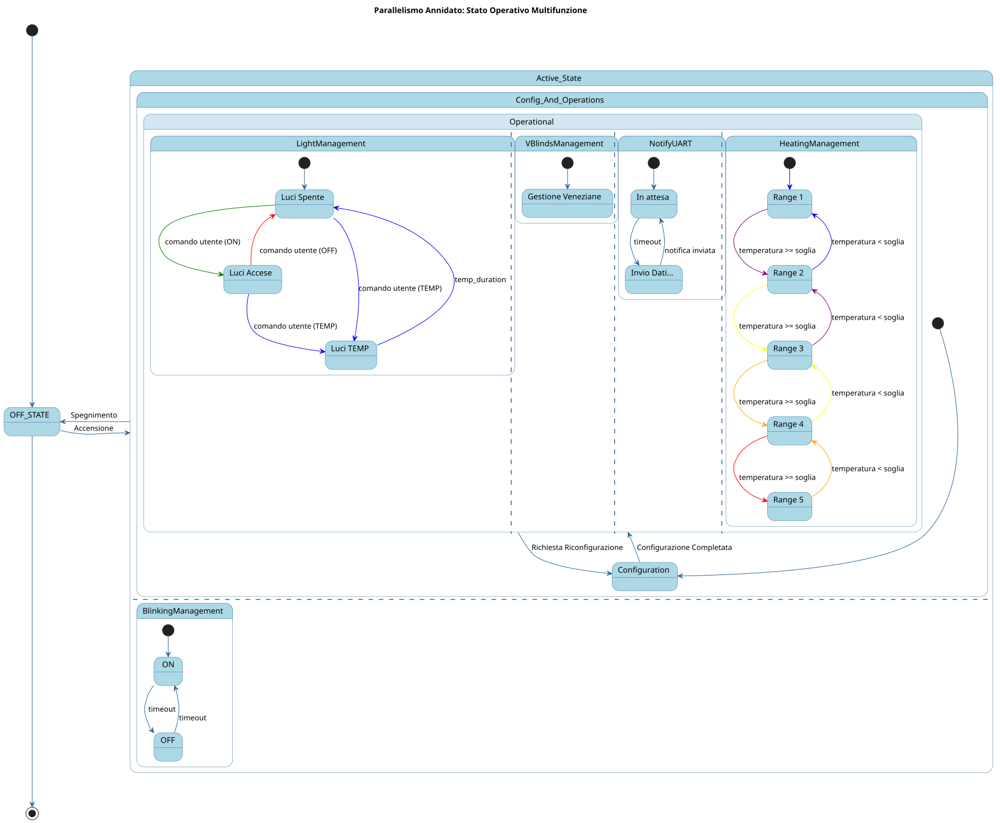
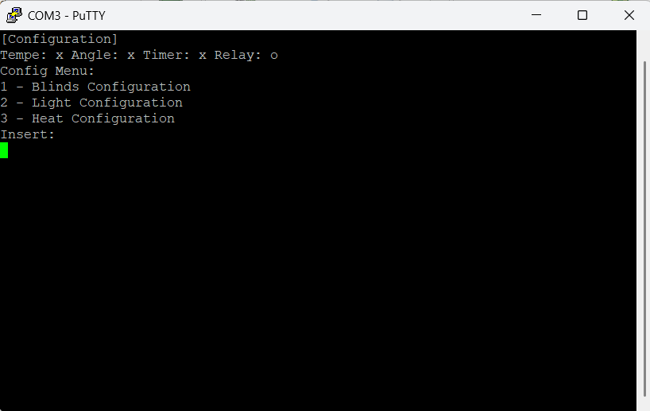
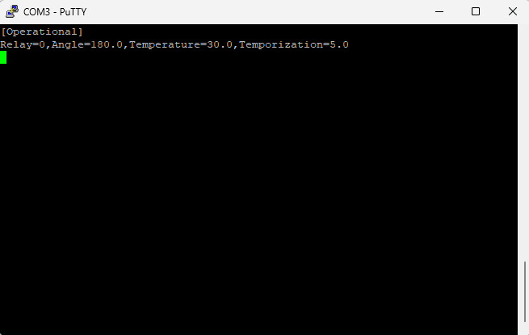
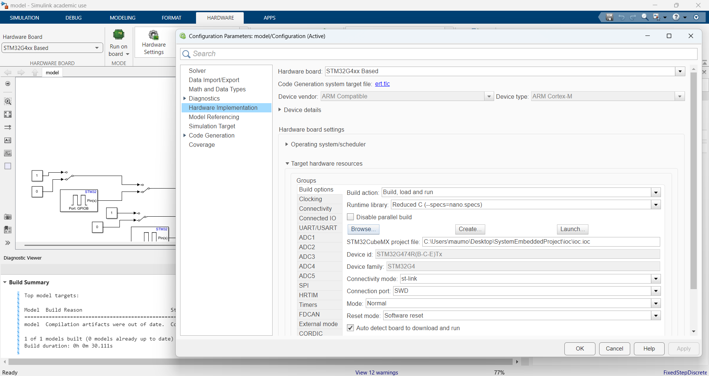
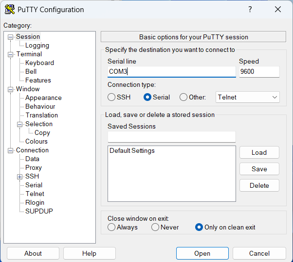

<div align="center">

# 🏠 Smart Home Controller on STM32

**Model-based firmware for a home-automation controller: blinds, lights and thermostat feedback driven by a hierarchical Stateflow state machine, auto-generated to C and deployed on an STM32 Nucleo board**


*Project work for **Embedded Systems**, MSc in Computer Engineering, University of Salerno (a.y. 2024/2025)*



</div>

---

## 📌 The problem

The goal is the firmware of an **integrated home-automation device** that manages:

1. **Venetian blinds**: opening angle driven by a servo motor
2. **Lights**: on/off and timed switch-on through a relay
3. **Heating**: thermostat set-point shown as a colour on an RGB LED

The user interacts through **four physical buttons** (CONFIG, ACTIVATE, LIGHTS, TIMED LIGHTS) and a **UART console** that shows an interactive configuration menu and a periodic status report.

Main requirements:

- At first boot the device has **no configuration**, so it must stay in configuration mode until a valid one is entered.
- Configuration is only allowed while the device is **active**; invalid values are **rejected** and the last valid configuration is kept.
- When active, the user LED **blinks at 2 Hz** and the status is sent over UART **every 10 s**.
- When inactive, every output goes to a safe state: blinds closed, lights off, temperature at minimum.

---

## ⚙️ Configurable parameters

| Function | Range | Resolution |
|---|---|---|
| Blinds | 0° (closed) – 180° (open) | 20° |
| Lights | ON / OFF | – |
| Timed lights | 5 – 30 s (0 = disabled) | 1 s |
| Temperature | 16 °C – 30 °C | 1 °C |

### RGB LED temperature feedback

| Temperature | Colour | R, G, B |
|---|---|---|
| 16 – 18 °C | 🔵 Blue | 0, 0, 255 |
| 19 – 21 °C | 🟣 Purple | 128, 0, 128 |
| 22 – 24 °C | 🟡 Yellow | 255, 255, 0 |
| 25 – 27 °C | 🟠 Orange | 255, 128, 0 |
| 28 – 30 °C | 🔴 Red | 255, 0, 0 |

---

## 🧠 Architecture: a hierarchical, parallel state machine

The whole control logic is a **finite state machine modelled in MATLAB Stateflow**, following a top-down design. Embedded Coder generates C code from the model, which is then built, flashed and run on the board directly from Simulink.

```text
Chart
├── OFF_STATE                     all outputs in safe state, waits for ACTIVATE
└── Active_State
    ├── Config_And_Operations
    │   ├── Configuration         UART menu, input buffer, validation, feedback
    │   └── Operational           ┐
    │       ├── LightManagement   │ four parallel
    │       ├── VBlindsManagement │ orthogonal
    │       ├── NotifyUART        │ regions
    │       └── HeatingManagement ┘
    └── BlinkingManagement        user LED at 2 Hz, parallel to everything above
```

<div align="center">

</div>

- **BlinkingManagement** runs in parallel with `Config_And_Operations`, so the LED keeps blinking whether the device is configuring or operating.
- Inside **Operational**, the four functional regions run concurrently, so the system reacts at once to buttons, timers and new settings.

### 🔧 Configuration

- Interactive UART menu: `1 - Blinds`, `2 - Light`, `3 - Heat`.
- A status line tracks which parameters have been set at least once (`x` = not set, `o` = set): `Temp: x Angle: x Timer: x Relay: x`.
- **First access:** you can leave configuration only after **every** parameter has been set. **Later accesses:** changing at least one parameter is enough.
- **Fault-tolerant input:** only non-negative decimal numbers (e.g. `3.0`), Backspace and Enter are accepted; other characters are not echoed. Input longer than 20 characters gives a detailed error, and multi-byte escape sequences (e.g. the DEL key, `ESC [ 3 ~`) are handled safely.

### 💡 LightManagement

- Two cooperating sub-machines: **Operation** (normal on/off with LIGHTS) and **Temp** (timed switch-on with TIMED LIGHTS, `after(temp_duration, sec)`).
- LIGHTS during a timed switch-on turns the lights off early; TIMED LIGHTS during a timed switch-on has no effect.
- **Software debouncing** of every button, modelled as states (`WaitForButtonPressing → Debounce → WaitForRelease`), to filter contact bounce.

### 🪟 VBlindsManagement: servo PWM

TIM4 CH1 (PB6) generates a standard **50 Hz** servo signal:

```text
f_PWM = 16 MHz / ((PSC + 1) · (ARR + 1)) = 16 000 000 / (1600 · 200) = 50 Hz   → period 20 ms
Pulse = 5 + (vblinds_angle / 180) · 20                                         → [5, 25]
0°   → 5/200 · 20 ms  = 0.5 ms
180° → 25/200 · 20 ms = 2.5 ms
```

### 🌡️ HeatingManagement: RGB LED PWM

TIM3 CH1/CH2/CH3 drive the RGB LED. With **ARR = 254** and **PSC = 240** the 8-bit colour value (0–255) maps 1:1 onto the CCR register: 255 is above the counter's maximum, so the duty cycle saturates and no special cases are needed in software.

```text
f_PWM = 16 000 000 / ((240 + 1) · (254 + 1)) ≈ 260 Hz   → no visible flicker
```

Five states (`range_1` … `range_5`) with transitions on the temperature thresholds.

### 📡 NotifyUART

A two-state loop (`Send` ↔ `Wait 10 s`). `messageForUART` builds the status string in a **statically allocated 250-byte buffer** (no `malloc`), converting integers to ASCII with a custom `write_uint_decimal`, and sends only the useful bytes.

```text
[Operational]
Relay=0,Angle=180.0,Temperature=30.0,Temporization=5.0
```

### ✨ BlinkingManagement

`ON` ↔ `OFF`, each lasting `1 / (2 · blinking_hz)` s, so a full period lasts `1 / blinking_hz` = 0.5 s at 2 Hz.

---

## 🔌 Hardware: pin setup

Board: **STM32 NUCLEO-G474RE** (STM32G474RE, ARM Cortex-M4).

| Device | Pin | Notes |
|---|---|---|
| RGB LED: red | PA6 | TIM3 PWM CH1 |
| RGB LED: green | PC7 | TIM3 PWM CH2 |
| RGB LED: blue | PC8 | TIM3 PWM CH3 |
| User LED | PA5 | Status indicator (2 Hz blink) |
| Servo motor | PB6 | TIM4 PWM CH1 |
| Relay (lights) | PC2 | GPIO output |
| CONFIG button | PB0 | Enter / leave configuration |
| ACTIVATE button | PC13 | On-board user button |
| LIGHTS button | PB1 | Toggle lights |
| TIMED LIGHTS button | PA15 | Timed switch-on |
| UART RX | PA3 | LPUART1 RX |
| UART TX | PA2 | LPUART1 TX |

---

## 🖥️ UART console

<div align="center">


</div>

Serial settings: **9600 baud**, 8N1, no flow control (e.g. PuTTY on the board's COM port).

---

## ▶️ How to run

**Requirements:** MATLAB/Simulink with Stateflow and Embedded Coder, the *Embedded Coder Support Package for STMicroelectronics STM32 Processors*, STM32CubeMX, and a serial terminal (PuTTY).

1. Clone the repository and open `SystemEmbeddedProject_38_IZ/stateflow_model/model.slx` in Simulink.
2. Go to **Hardware → Hardware Settings → Target hardware resources → Build options** and use **Browse...** to select `stateflow_model/ioc/ioc.ioc`.

   

3. Connect the NUCLEO-G474RE via USB (ST-LINK) and press **Build, Deploy & Start**.
4. Open PuTTY on the board's COM port at **9600 baud**.

   

5. Press the **ACTIVATE** button (blue user button) to turn the device on. It enters configuration mode on first boot.

> If the console stays empty because it was opened after the `[Inactive State]` message, press the board's reset button.

---

## 📁 Repository structure

```text
.
├── SystemEmbeddedProject_38_IZ/
│   ├── stateflow_model/
│   │   ├── model.slx              Simulink/Stateflow model (the whole firmware logic)
│   │   └── ioc/ioc.ioc            STM32CubeMX configuration (pins, timers, LPUART)
│   └── documentation/
│       └── Project Work - SE - Gruppo 38.pdf   full report (Italian)
├── uml/                           PlantUML diagrams of the parallel states
└── assets/                        images used in this README
```

---

## 📄 Documentation

The full report (in Italian) is in [`SystemEmbeddedProject_38_IZ/documentation`](SystemEmbeddedProject_38_IZ/documentation/). It covers requirements analysis, pin setup, the software architecture, a detailed walkthrough of every state and the timer calculations.

## 👥 Authors

- **Francesco Monda**: [@cescomonda](https://github.com/cescomonda)
- **Leonardo Luongo**

Group 38 · Embedded Systems · University of Salerno
